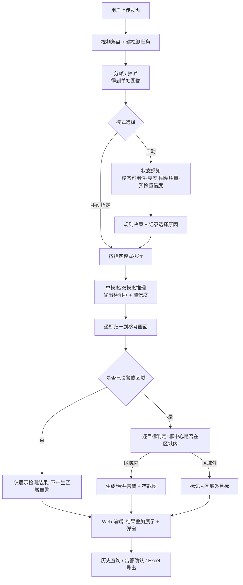

# 反无人机检测与预警系统 · 开发 README

> **版本** v0.1（初版，供组内讨论） · **整理日期** 2026-11-16
> **面向读者** 小组全体成员（3 人）
> **依据文档** 《实习选题表》（指导老师：谢今 副教授）、《项目需求说明书 V1.0》（2026-10-20）

---

## 0. 项目简介

给定一台**固定机位的摄像机**拍到的画面，系统自动判断画面里的无人机在哪儿；一旦无人机进入用户事先在界面上画好的**警戒区域**，就在 Web 界面上**弹出告警**并把这条告警存下来，可以事后查历史、导 Excel。

难点（也是本课题的卖点）在于：白天/夜间、正常光照/弱光/逆光、清晰/模糊等不同条件下，**可见光（RGB）相机和红外（Thermal）相机哪个更好用是不一样的**。所以我们要做的是——准备好 RGB、T(Thermal)、RGB+T 融合三套检测模式，并让系统**根据当前画面条件自动挑一个合适的模式**，同时允许用户手动指定、并把三种模式的效果和耗时**量化对比**出来。

---

## 1. 项目背景与目标

### 1.1 要解决的问题

小型无人机成本低、机动性强，对重点区域（厂区、变电站、监狱、机场周边、大型活动场地等）的安全威胁越来越现实。传统的纯可见光监控在**夜间、逆光、雾霾、复杂背景**下会明显失效；红外成像对"热源目标"敏感，在这些场景下反而更稳，但分辨率低、纹理信息少。

因此本课题的思路是：

- **单模态兜底**：RGB 单独能测、T 单独能测；
- **双模态协同**：两路都可用时融合，提升弱光/夜间/复杂背景下的检测性能；
- **自适应选择**：系统根据"模态是否可用 + 光照/图像质量 + 检测置信度"自动决定用哪种模式，并把选择理由记下来（可解释、可复现）；
- **落到业务上**：检测结果要能变成"区域侵入 → 告警 → 确认 → 归档/导出"这条完整业务闭环，并且是 Web 系统。

### 1.2 我们要交付什么（目标成果）

按《选题表》的结题考核要求，最终要交这些东西：

| 类别 | 具体交付物 | 负责人 |
|---|---|---|
| 源代码 | 完整可运行工程（算法 + 后端 + 前端），含 README、依赖清单、部署说明 | 全体 |
| 模型 | RGB / IR 单模态权重、双模态融合权重、自适应策略配置（或明确的获取/训练说明） | 算法同学 |
| 软件工程文档 | 需求与功能分析文档、**设计报告**、**测试报告** | 组长统筹，各模块自写 |
| 验收材料 | 答辩验收 PPT、**演示 Demo**（含录屏备份，防止现场翻车） | 全体 |
| 实验记录 | 三种模式 + 自适应策略的**对比实验结果**（精度 + 耗时），固定数据划分、可复现 | 算法同学 |
| 过程材料 | 3 份项目进度报告书（10 月底、11 月底、12 月底各一份） | 组长 |

> 需求说明书的验收口径（第 5.1 节）很明确：至少两个普通用户 + 一个管理员账号跑通全流程、越权访问要被拦住、三种模式都能出结果、区域内/区域外/无目标三种情况判定正确、告警确认后刷新页面状态还在、查询条件和 Excel 导出内容一致、损坏文件/配对缺失/推理失败都有明确提示。**这些就是我们的"完工定义"**

---

## 2. 系统边界

### 2.1 首版要做

- 输入：**固定机位视频**（本地视频文件），系统按帧拆开，**每一帧当作一张图片**走检测流程；
- 检测模式：可见光单模态、红外单模态、双模态协同；
- 模式选择：手动指定 + 自动选择（自动选择要**记录选择原因**）；
- 警戒区域：用户在 UI 上画框指定，区域与画面绑定；
- 侵入判定：检测框**中心点**落在警戒区域内 → 判为侵入；
- 告警：弹窗提示 + 持久化存储（含时间、来源画面、目标位置、截图）；
- 告警确认：用户确认本人的告警，记录确认人/确认时间；
- 历史查询：按时间、模式、确认状态筛选；
- Excel 导出：导出当前筛选结果；
- 账户体系：登录/退出，管理员建号、禁用、重置密码；普通用户只能看自己的数据；
- 实验评估：三种模式 + 自适应策略的效果与耗时对比。

### 2.2 首版明确不做

目标跟踪与轨迹分析、跨帧告警抑制（注：见 §12-Q2，视频场景下需要给个折中方案）、地图定位与经纬度、测距、无人机型号识别、短信通知、硬件干扰/反制、网页端训练、复杂模型版本管理、对接外部监控平台。

> 后续扩展顺序按需求说明书：**本地视频 → 视频流 → 摄像头**。我们这次把"本地视频"提前纳入首版，架构上要给后两者留口子（帧输入这一层要抽象干净）。

---

## 3. 关键术语

| 术语 | 含义 |
|---|---|
| RGB / 可见光 | 可见光相机采集的图像 |
| T / IR / 红外 | 红外热成像模态；RGB-T 指成对的可见光 + 红外图像 |
| 双模态协同 | 同时利用两种模态信息做检测（融合层次待定，见 §7.2） |
| 自适应选择 | 根据模态可用性、亮度、图像质量、检测置信度等，按规则选检测模式 |
| 参考模态 / 参考画面 | 双模态输出统一到同一套坐标系，需要指定以哪一路为基准（本项目**建议以 RGB 为基准**，因为 UI 上展示的是彩色图） |
| 区域侵入 | 单帧中检测框**中心点**位于用户指定区域内。注意：这**不代表**观测到了完整的"进入过程" |
| 告警确认 | 用户已查看并确认该告警的业务状态，**不等于**重新判定检测结果真伪 |

---

## 4. 系统是怎么跑起来的（总体流程）



要点：

1. **"视频" 只是入口**。分帧之后，处理链路和"上传一张图片"完全一样。所以算法同学先把 **单帧（图片）链路**做扎实，视频再包一层；反过来做会很痛苦。
2. **告警是帧级判定、事件级呈现**。视频每秒几十帧，如果每帧都生成一条告警，数据库会被灌爆、用户会被弹窗淹没。必须在"生成告警"这一步做归并（见 §12-Q2）。
3. **坐标系必须从第一天就统一**。区域坐标、检测框坐标、前端展示坐标、导出数据坐标，全部基于同一个参考画面 + 同一套归一化约定，否则后期全是 bug。

---

## 5. 开发任务拆解（按模块）

下面每个模块都标了 **输入 / 输出 / 验收标准**，方便各自认领和自测。

### M1 视频接入与分帧

- **输入**：本地视频文件（mp4/avi 等）
- **输出**：有序的帧序列（帧号 + 时间戳 + 图像），以及视频元信息（分辨率、帧率、总帧数）
- **要做的事**：
  - 校验格式/可读性，失败要能明确报错（需求 FR-03、§3.5）
  - 抽帧策略可配置：全帧 / 按步长跳帧（视频检测建议先做跳帧，否则耗时扛不住）
  - 支持"成对输入"：RGB 视频 + IR 视频，按时间戳对齐配对（见 §12-Q4）
- **验收**：给定一段视频，能稳定产出帧序列；坏文件不崩、有提示。

### M2 单模态检测（RGB / IR）

- **输入**：单帧图像
- **输出**：`[{bbox, score, class}]`、实际模式、耗时
- **要做的事**：基于 UAV_CB RGB-T 数据集分别训练 RGB 检测器与 IR 检测器；统一推理封装（同一接口，换模型不改上层）
- **验收**：固定测试集上给出 P / R / mAP，并注明阈值、IoU 口径、输入尺寸、样本数。

### M3 双模态协同检测

- **输入**：成对的 RGB-T 帧
- **输出**：同 M2，但坐标统一到参考画面（RGB）
- **三条可选路线**（详见 §7.2，建议先落地结果级融合保证有交付，再冲特征级融合）
- **验收**：与单模态在同一测试划分、同一口径下对比，报告精度与耗时。

### M4 自适应模式选择

- **输入**：当前帧可用的模态 + 图像状态指标
- **输出**：选定的模式 + **选择原因**（字符串/结构化字段，必须持久化）
- **要做的事**：
  - 状态感知：模态可用性（有没有 IR 通道）、亮度（均值/直方图）、图像质量（对比度、清晰度、噪声估计）
  - 决策规则：先定规则式（if-else / 打分表），要有阈值、可配置；进阶可考虑用检测置信度做二次判断
  - 兜底：规则无法判断或有冲突时，回退到默认模式并**记录回退原因**，绝不静默切换用户手动指定的模式（需求 §3.5）
- **验收**：给出规则表 + 阈值；在样例集上能看出"夜间自动切 IR"这类行为的合理性；额外推理的耗时要计入总耗时（FR-06）。

### M5 警戒区域与侵入判定

- **输入**：用户绘制的区域 + 检测框
- **输出**：每个目标的"区域内/区域外"判定结果
- **要做的事**：
  - 前端画框 → 提交**归一化坐标**（0~1）+ 参考画面尺寸，后端校验范围
  - 区域与来源画面绑定，**不默认跨场景复用**（FR-08）
  - 侵入判定：框中心点 ∈ 区域；边界点计为区域内（候选规则，待确认）
  - 未设置区域时：只检测、不产生区域告警
- **验收**：构造"区域内/区域外/无目标/无区域"四类用例，判定全部正确。

### M6 告警管理与确认

- **输入**：侵入判定结果
- **输出**：告警记录（告警 ID、所有者、检测任务、时间、来源画面、目标位置、截图、确认信息）
- **要做的事**：生成、去重归并、存截图、确认操作（记录确认人 + 确认时间）、列表与详情查询
- **验收**：确认后刷新页面状态仍为已确认；普通用户看不到别人的告警；管理员可见全部。

### M7 Web 后端

- **输入**：前端请求
- **输出**：REST API
- **要做的事**：
  - 认证鉴权（密码**不得明文存储**，用 bcrypt/argon2；登录态用 JWT 或 Session）
  - **每一条业务查询都必须带资源所有者过滤**（越权是本项目验收的必查项，FR-02）
  - 检测任务编排（同步/异步、状态机：处理中 / 成功 / 失败 / 超时）
  - 文件存储与数据库记录保持关联，**禁止可通过可猜测路径绕过权限**（§3.4）
  - Excel 导出（openpyxl），时间与状态表达要和页面一致
- **验收**：Postman/文档能跑通全流程；越权请求返回 403；异常路径有明确错误码与提示。

### M8 Web 前端

- **输入**：用户操作
- **输出**：可用的界面
- **要做的事**：
  - 登录页、视频上传页、检测结果页（画面 + 检测框叠加 + 置信度 + 模式 + 选择原因）
  - **Canvas 画框组件**：支持拖拽绘制、调整、删除；**页面缩放时坐标要正确换算**（需求 §3.2.1 明确要求）
  - 告警弹窗 + 告警列表/详情 + 确认按钮 + 历史查询筛选 + 导出按钮
  - 状态必须能清楚区分：处理中 / 成功 / 失败 / 无目标 / 区域外目标 / 区域侵入
- **验收**：非技术用户（找同学/家人当小白鼠）能独立完成"上传 → 查看结果 → 画框 → 看到告警 → 确认"。

### M9 实验评估（贯穿全程，最后收口）

- 固定数据划分 + 固定配置，四组对比：**RGB 单模态 / IR 单模态 / 双模态融合 / 自适应策略**
- 指标：Precision、Recall、mAP@0.5（可加 mAP@0.5:0.95）；耗时：模型推理耗时 **和** 端到端耗时分开记
- 记录项：硬件、输入尺寸、预热次数、重复次数、并发情况
- **红线**：不得用测试集调参；数据划分要按场景/连续帧分组，防止相邻帧泄漏（需求 §3.2.1）

---

## 6. 数据与评估口径

- **数据集**：现有约 **3000+ 对 UAV_CB RGB-T** 图像（可见光 + 热红外成对）。
- **已知坑（措辞要准确）**：两种模态**未做像素级配准**，受视差与传感器机械偏移影响，
  RGB 与 T 里同一个目标的像素位置**并不严格重合**，**不能直接假定位置一致**。
  > 需求说明书写的是"两种模态存在轻微拍摄时间差"，但原始数据集论文的说法是：
  > 两路视频流**已用硬件时间戳做帧级同步**，问题出在**空间未配准**，不是时间不同步。
  > 结论一样，但**报告和答辩要按"空间未配准"来讲**，说成"时间不同步"会被问穿。
- 这意味着——
  - **输入级融合**（RGB+IR 拼 4 通道）风险最高，直接假设逐像素对齐；
  - **结果级融合**（两路各自检测再融合框）最稳，对不配准天然免疫，适合当保底方案；
  - **特征级融合**居中，但必须自带跨模态对齐机制（如 LFBNet 的频域对齐 + 可变形卷积），
    裸 concat 效果会打折；
  - 精确配准与同步校正**不列为首版必做功能**（需求 §2.3），但要在报告里说明处理方式。
- **划分要求**：训练/验证/测试固定；核查相邻帧与相似场景，**避免高度相似图片跨集合**导致指标虚高。
- **不可复现 = 不算成果**：模型版本、超参、数据划分、阈值都要记录，实验记录要能被别人重跑。
- **置信度**：模型输出分数，**不是**经过校准的真实概率，报告里别写成"概率"。

---

## 7. 技术方案建议

### 7.1 技术栈（建议，可讨论）

| 层 | 建议选型 | 理由 |
|---|---|---|
| 训练/推理 | Python 3.10 + PyTorch 2.x + **Ultralytics YOLO** | 生态成熟、单阶段检测上手快、6GB 显存可跑 |
| 加速 | AMP 混合精度、imgsz=640、小 batch | RTX 4050 **6GB** 显存偏紧，双流模型尤其要省 |
| 后端 | **FastAPI** + Uvicorn + SQLAlchemy | 异步、自带 OpenAPI 文档，前后端对接省事 |
| 数据库 | **PostgreSQL 16**（开发与部署同一个，不走 SQLite） | 见下方说明 |
| 前端 | **Vue 3 + Vite + Element Plus + Pinia + Axios** | 组件全、上手快；画框用原生 Canvas 或 Fabric.js |
| 部署 | Docker Compose（脚手架已就位，见 [docs/docker-dev.md](docs/docker-dev.md)） | 验收时"一条命令起来"很加分 |
| 实验 | 自写评估脚本 + CSV/JSON + matplotlib | 图能直接塞进报告 |

> **关于数据库：为什么开发也不用 SQLite？**
>
> 原本的设想是「开发 SQLite、部署 PostgreSQL」，但容器化之后这个理由消失了——
> `docker compose up -d` 就有一条一模一样的 PostgreSQL，零安装成本。
> 而同时用两套库的代价是真实的：
>
> - **方言差异**：`JSONB`、`ON CONFLICT`、数组类型、`ILIKE`、时间戳与时区处理和 SQLite 都不一样；
>   本地跑通的 SQL 上服务器报错，是最难查的一类 bug。
> - **检测结果要存框坐标**，`JSONB` 在 PG 里能直接查、能建索引，SQLite 只能当字符串存。
> - **并发**：SQLite 是库级写锁，视频分帧 + 多用户同时提交检测时容易撞 `database is locked`。
> - **迁移只写一遍**：`alembic` 的迁移脚本在开发和生产上验证的是同一份。
>
> 结论：**开发、测试、部署统一用 PostgreSQL 16**，省下的是排查方言 bug 的时间。
> 表结构与日常迁移命令见 [docs/database.md](docs/database.md)。

> 技术栈不是重点，**能跑通、能解释**才是。如果组内有更熟的栈（React、Flask 等），换掉没问题，但要在 README 里改掉并说明。

### 7.2 双模态融合的三条路线

| 路线 | 做法 | **要重新训练吗** | 难度 | 风险 | 建议 |
|---|---|---|---|---|---|
| 结果级（Late Fusion） | 两路独立检测 → 框融合（WBF / NMS / 加权） | ❌ **不用**，直接复用已训练的两个单模态模型 | 低 | 提升有限 | **先做，作为保底方案** |
| 特征级（Feature Fusion） | 双 backbone，中层特征 concat/add 后统一检测头 | ✅ **要**（可从单模态权重热启动） | 中高 | 依赖对齐，显存吃紧 | **主攻方向，本项目创新点** |
| 输入级（Early Fusion） | RGB+IR 拼 4 通道送单 backbone | ✅ **要**，且第一层 3→4 通道要改 | 低 | 强依赖像素级对齐，本项目数据**未配准** | 谨慎，最多做对照 |

> **这条区分决定了 11–12 月的排期**：结果级融合零训练成本，做完单模态就能拼出
> 完整可演示的系统；特征级融合必须重训，属于"必须提前排期、否则 12 月交不出东西"的实验。

> **📌 重要参考**：本数据集来自论文 **UAV-CB: A Complex-Background RGB–T Dataset and
> Local Frequency Bridge Network for UAV Detection**（CVPR 2026，
> [arXiv:2603.17492](https://arxiv.org/abs/2603.17492)）。它做的是**同一数据集上的同一个任务**，
> 提出的 **LFBNet 属于典型的「特征级（中期）融合」**：双流分支各自提特征 → 频率域跨模态对齐
> （LFCA）→ 频率引导的可变形空间对齐（FGSA）→ 对称交叉条件融合 → 单一 FPN(YOLOv5s) 检测头。
>
> **但复现成本要认清**：论文用 **ResNet-50 双流 + A100 40GB + batch 16 + 200 epochs**，
> 输入 640×512，参数量 30.2M / 65.2 GFLOPs（YOLOv5s 只有 7.2M / 13.5G）。
> 在 6GB 的 4050 上**无法照搬**。现实做法是：把它作为报告里的 **SOTA 对照**，
> 自己实现一个轻量版特征融合（轻量 backbone + 单个对齐模块），不要试图还原整个网络。

> **⚠️ 一个必须知道的反直觉结论**：论文 Table 2 里，最简单的特征拼接融合
> （`YOLOv5s+Add`）AP50 只有 **72.8**，**低于热红外单模态的 78.2**。
> 也就是说**朴素融合会让效果变差**。融合不是稳赚，必须有对齐机制才划算——
> 这条直接决定了你们"双模态协同"章节怎么写，别默认"融合一定更好"。
>
> 完整基线数据见 [docs/training.md](docs/training.md) §9。


### 7.3 自适应选择策略（初版规则草案）

```
输入: 模态可用性 (has_rgb, has_ir)、亮度均值 L、对比度 C、清晰度 S
输出: mode ∈ {rgb, ir, fusion} + reason

if not has_ir:            mode = rgb,    reason="红外通道缺失"
elif not has_rgb:         mode = ir,     reason="可见光通道缺失"
elif L < L_dark:          mode = ir,     reason=f"低照度(L={L:.1f})，切红外"
elif C < C_low or S < S_low: mode = fusion, reason="图像质量差，启用双模态协同"
else:                     mode = rgb,    reason="光照与质量正常，用可见光"
```

阈值（`L_dark` / `C_low` / `S_low`）**必须通过基线实验确定并在报告里写清楚**，不能拍脑袋。进阶版可以引入"先用 RGB 预检，置信度低于阈值再触发 IR/融合"的二次决策（FR-06 提到"额外推理计入耗时"——这正是它的代价）。

---

## 8. 建议的仓库结构

```
uav-alert-system/
├── README.md
├── docker-compose.yml        # 一键起 db + api（见 docs/docker-dev.md）
├── .env.example              # 复制成 .env 用；.env 不进仓库
├── docker/
│   ├── backend.Dockerfile    # 后端 API（CPU）
│   ├── ml.Dockerfile         # 训练/推理（CUDA）
│   └── web.Dockerfile        # 前端（可选）
├── backend/                  # FastAPI
│   ├── requirements.txt
│   ├── alembic.ini           # 数据库迁移配置
│   ├── alembic/versions/     # 迁移脚本（已生成首个 init schema）
│   ├── app/
│   │   ├── main.py
│   │   ├── core/             # 配置、安全(JWT)、鉴权依赖、错误类型
│   │   ├── db/               # Base / 会话
│   │   ├── models/           # ORM 模型（7 张表，见 docs/database.md）
│   │   ├── api/              # auth / media / regions / tasks / alerts（已实现）
│   │   ├── schemas/          # Pydantic 请求/响应
│   │   ├── services/         # ★ 业务核心：selector / detector / intrusion / frames / pipeline / render
│   │   └── scripts/          # seed_admin / smoke_test / e2e_test
│   └── tests/
├── frontend/                 # 前端
│   ├── app/                  # ★ 独立前端（多页，跑在 5173）
│   │   ├── index.html        # 入口跳转
│   │   ├── login.html / register.html
│   │   ├── upload.html       # 上传素材 + 划定警戒区域
│   │   ├── tasks.html        # 检测任务列表
│   │   ├── task.html         # 检测详情（播放/进度/区域轮廓/报警标记/导出）
│   │   ├── alerts.html       # 报警画廊
│   │   ├── common.js         # 请求/鉴权/blob/格式化/顶栏
│   │   ├── style.css
│   │   └── pages/            # 每个页面各自的脚本
│   └── mvp/                  # 早期 MVP 控制台（后端托管在 /ui）
│       ├── index.html
│       └── test/draw.test.js # 画框逻辑的无浏览器回归测试
├── ml/                       # 算法（独立于 Web，可单独跑）
│   ├── requirements.txt
│   ├── datasets/
│   │   ├── inspect_dataset.py   # ① 先探数据格式
│   │   └── prepare_yolo.py      # ② 转 YOLO + 防泄漏划分
│   ├── models/                  # rgb / ir / fusion（待建）
│   ├── selector/                # 自适应策略（待建）
│   ├── train.py                 # ③ 训练
│   ├── evaluate.py              # ④ 评估（P/R/mAP + 耗时）
│   └── infer.py                 # ⑤ 对外统一推理接口（backend 调用这里）
├── data/                     # 数据集（不入库，.gitignore）
├── docs/                     # 需求/设计/测试报告、实验记录
│   ├── architecture.md       # ★ 后端分层与接手说明（组员先看这个）
│   ├── frontend.md           # ★ 独立前端：页面/接口对应、注册冲突、两个技术坑
│   ├── api.md                # 接口与业务约定（前后端并行开发的契约）
│   ├── database.md           # 表结构与迁移
│   ├── docker-dev.md         # 环境搭建
│   ├── training.md           # 单模态检测实现流程
│   └── handover-*.md         # 每日交接记录（最新一份先看）
└── scripts/                  # 分帧、数据预处理等
```

**关键约定**：`ml/` 与 `backend/` 之间只通过一个稳定接口通信（输入：帧/视频 + 模式；输出：检测框 + 置信度 + 实际模式 + 原因 + 耗时）。接口先定，后面各自并行开发，互不阻塞。

---

## 8.1 当前可运行状态

**已经能端到端跑通**（模型用桩替代，检测逻辑真实）。现在有**两套前端**：

```powershell
docker compose up -d                        # 后端 8000 + 数据库
docker compose --profile web up -d          # 独立前端 5173

# ① 独立前端（按《登录界面.docx》实现）：http://localhost:5173/
#    登录/注册 + 检测任务列表 + 检测详情(播放/进度/报警标记) + 报警画廊
# ② MVP 控制台（含上传与画框）：http://localhost:8000/ui/
```

两套前端共用同一套后端接口。上传入口目前在 MVP 控制台里
（业务界面文档未要求上传，见 `docs/frontend.md` §6）。

接口文档：<http://localhost:8000/docs>

| 能力 | 状态 |
|---|---|
| 登录 / JWT / 越权拦截 | ✅ |
| 注册（受开关控制，默认关闭以符合 FR-01） | ✅ 见 `docs/frontend.md` §4 |
| 上传图片或视频（可成对上传红外） | ✅ |
| **自适应选模态**（亮度/对比度/清晰度 → rgb/ir/fusion） | ✅ 逻辑真实，阈值待标定 |
| 手动模式校验（输入不匹配拒绝） | ✅ |
| 分帧（stride 抽帧、原始帧号语义） | ✅ |
| 区域绘制（归一化坐标）| ✅ |
| 侵入判定（框中心 ∈ 区域） | ✅ |
| 告警生成 / 归并 / 确认 | ✅ |
| 帧级结果（含无目标帧） | ✅ |
| 视频流播放与跳看（HTTP Range） | ✅ 需 H.264 编码 |
| 检测模型 | ⚠️ **桩**，等训练完成后切 `DETECTOR_BACKEND=ultralytics` |
| Excel 导出 / 用户管理 / 异步任务 | ❌ 未做，见 `docs/architecture.md` §6 |

自测命令：

```powershell
docker compose exec api python -m app.scripts.e2e_test
```

---

## 9. 里程碑与时间表

| 阶段 | 时间 | 内容 | 状态 |
|---|---|---|---|
| 1 | 9.12 – 9.30 | 撰写实习项目申请表 | ✅ 已完成 |
| 2 | 10.1 – 10.30 | 需求分析、总体方案设计、数据整理、RGB/IR 单模态模型构建 → **第一份进度报告** | ⬜ 待更新 |
| 3 | 11.1 – 11.30 | 双模态协同模型 + 自适应选择策略 + 模型对比实验 → **第二份进度报告**（**← 我们在这里**） | 🟨 进行中 |
| 4 | 12.1 – 12.30 | 入侵预警、可视化系统、各模块集成、系统测试与优化 → **第三份进度报告** | ⬜ 未开始 |
| 5 | 1.11 – 1.15 | 整理文档、源码、演示 Demo、答辩 PPT，**项目答辩验收** | ⬜ 未开始 |

**硬节点**：需求说明书约定 **2027-01-10 左右完成首版交付**，答辩在 1.11–1.15。倒推回来，**12 月中必须有一个能完整演示的系统**，留给修 bug 和写文档的时间只有半个月。

---

## 10. 分工建议（待组内确认）

按"算法 / 后端 / 前端"三层切，各自主责一摊，接口先行、并行开发：

| 成员 | 主责 | 具体任务 | 产出 |
|---|---|---|---|
| **A（组长）** | 算法主线 + 统筹 | 双模态融合（结果级→特征级）、自适应选择策略、实验设计与评估、进度报告、文档统筹 | 融合模型、选择策略、对比实验报告 |
| **B** | 算法工程 | 数据集整理与划分、RGB/IR 单模态训练调优、推理接口封装与加速、坏数据处理 | 单模态权重、推理服务接口 |
| **C** | Web 全栈 | 后端 API/鉴权/数据库/告警逻辑/Excel 导出 + 前端页面/Canvas 画框/结果叠加 | 可运行 Web 系统 |
## 11. 协作规范（建议）

- **Git**：`main` 保持可运行；功能开发走 `feat/xxx` 分支；合并前自测。
- **提交信息**：`feat: 增加区域绘制组件` / `fix: 修正缩放坐标换算` / `docs: 补充接口说明`。
- **接口先行**：前后端先把 API 契约（路径、参数、返回、错误码）定下来，再各写各的。

- **配置与密钥**：数据库密码、密钥走 `.env`，**不进仓库**；`.gitignore` 掉 `data/`、`*.pt`、`__pycache__`。
- **文档即代码**：实验记录、阈值、模型版本随手记进 `docs/`

---

## 12. 变更记录

| 版本 | 日期 | 变更 | 作者 |
|---|---|---|---|
| v0.1 | 2026-11-16 | 初版：项目目标、边界、模块拆解、里程碑、分工建议、待确认问题 | 组长 |
