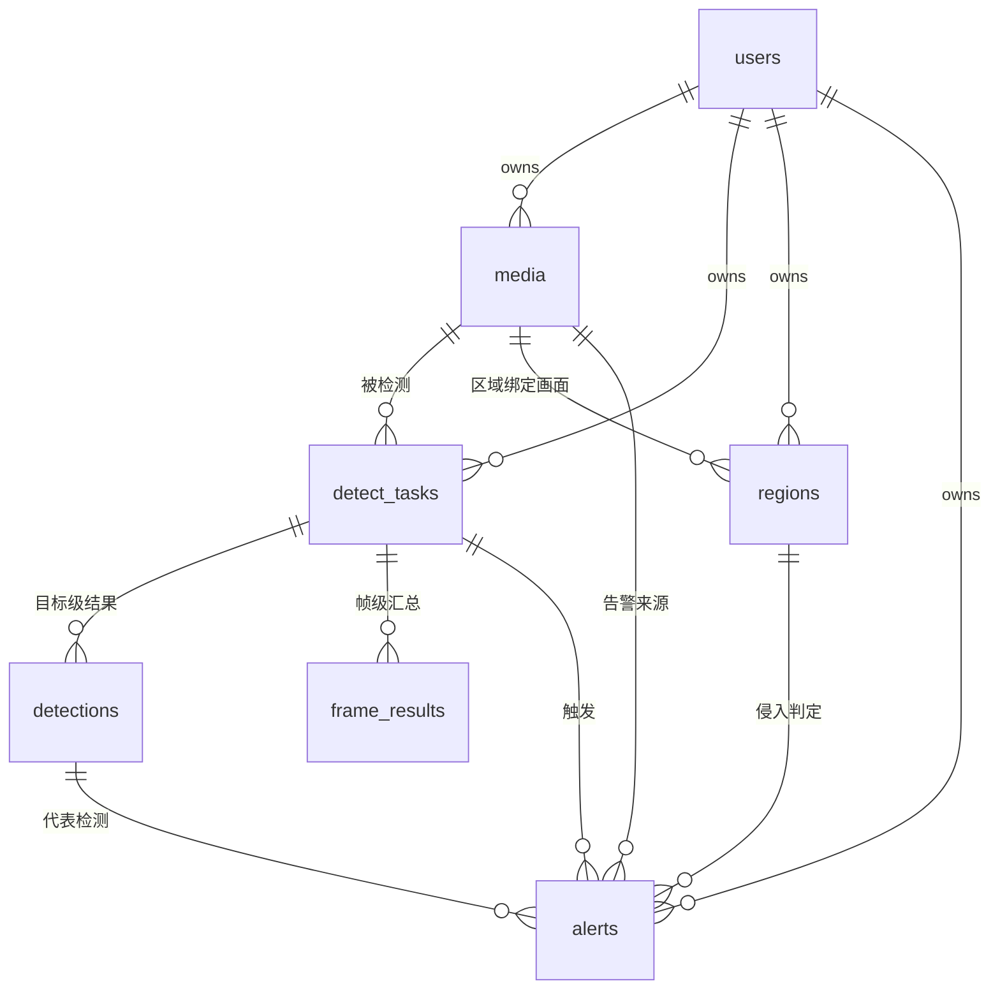

# 数据库设计说明

> 数据库 **PostgreSQL 16.16**｜ORM **SQLAlchemy 2.0**｜迁移 **Alembic**
> 模型代码：`backend/app/models/`　迁移版本：`backend/alembic/versions/`

---

## 1. 表一览

| 表 | 作用 | 对应需求 |
|---|---|---|
| `users` | 账户、角色、启用状态 | FR-01、FR-02 |
| `media` | 视频/图片源及其元信息 | FR-03 |
| `detect_tasks` | 一次检测任务（模式、参数、状态、耗时） | FR-04~FR-07、FR-13 |
| `detections` | **目标级**检测结果（每个目标一行：框、置信度） | FR-04 |
| `frame_results` | **帧级**处理记录（每处理一帧一行，含无目标的帧） | FR-04、FR-09 |
| `regions` | 用户绘制的警戒区域 | FR-08 |
| `alerts` | 区域侵入告警与确认 | FR-09~FR-12 |

## 2. 关系图



数据隔离方式：**每张业务表都有 `owner_id`**，查询时必须带上所有者过滤。
管理员看全部靠的是"不过滤"，不是另一套表（FR-02）。

---

## 3. 七个关键设计决策

### 3.1 坐标一律归一化到 [0,1]

`detections` 的 `x1,y1,x2,y2` 和 `regions.points` 都存 `[0,1]` 的小数，不存像素。

**为什么**：需求 §3.2.1 明确"页面缩放时应正确换算坐标"。存归一化值后，
前端不管画布多大、后端不管原图多宽，都不用重算。像素坐标要用时乘一下 `media.width/height` 即可。

### 3.2 相机分两套尺寸

UAV-CB 的 RGB 是 **1920×1080**，热红外只有 **640×512**。
所以 `media` 里有 `width/height`（参考画面 = RGB）和 `ir_width/ir_height` 两套。
**只用一套会直接导致红外框画到错位置。**

每行检测结果带 `ref_modality`，标明它属于哪个坐标系（FR-07 要求"说明参考模态"）。

### 3.3 不为一帧建一行

一个 10 分钟 25fps 的视频 = 15000 帧。如果把每帧当成一条 `media` 记录，库会直接爆掉。

所以：**`media` 只有一条记录，帧由 `detections.frame_index` 表达**，图像本身留在磁盘上。

### 3.4 检测结果与业务判定分离

`detections` 里**只放模型输出**（框、置信度），**不放"是否在区域内"**。

原因：「区域内」是业务规则，规则会改（矩形→多边形、边界点算不算内、多区域）。
把它写在检测结果里，改规则就要回头改历史数据。判定结果放 `alerts`，重算随时能做。

### 3.5 告警有归并字段

`alerts` 里有 `occurrence_count / first_seen_at / last_seen_at`。

原因见 README §12-Q2：需求说首版不做跨帧告警抑制，但又要视频输入。
25fps 下每帧都可能触发，不归并就会刷屏。做法是同一 `(media, region)` 上
时间相近的判定并入同一条告警，累加次数而不是插新行。
**这不是目标跟踪，只是告警去重**，不违反"首版不做跟踪"的边界。

### 3.6 枚举是 varchar，不是 PG 原生 ENUM

`role`、`status`、`mode` 这些列落库是 `varchar(16)`，**没有 CHECK 约束**。

这是有意的：后期加枚举值（比如告警加 `dismissed`）不需要任何迁移。
代价是数据库层不拦非法值，**合法性由应用层 Pydantic schema 保证**。
想要硬约束的话见 `backend/app/models/enums.py` 里的说明。

### 3.7 帧级记录单独一张表，且 `frame_index` 是原始帧号

这是最初设计里漏掉的一块，后来补上的。

**问题**：`detections` 只在**检出目标**时才有行。如果第 120 帧处理了但画面里没有
无人机，表里没有任何痕迹——于是"这帧处理过没有"和"处理过但没目标"就分不清了。
而需求要求页面能区分六种状态：处理中 / 成功 / 失败 / **无目标** / 区域外目标 / 区域侵入。

**方案**：`frame_results` **每处理一帧就写一行**，无论有没有目标。

```
无目标  ⟺  target_count = 0
有侵入  ⟺  intrusion_count > 0
```

**代价**：行数 = 处理帧数。10 分钟 25fps、`frame_stride=5` 约 3000 行/任务。
**收益**：前端一次查询就能拿到整条时间轴，"哪几秒有无人机"可以直接画出来。

**⚠️ `frame_index` 的语义必须钉死**：它是**原始视频中的帧号，从 0 起**，
**不是"抽帧后的第几个样本"**。

`frame_stride=5` 时它会是 `0, 5, 10, 15...`，**跳跃是正确的**。理由：

1. 只有这样才能和 `frame_ts_ms` 对上：`ts = frame_index / fps * 1000`
2. 只有这样才能跳回原视频第 120 帧去看现场，否则复现不了

> 这条不写清楚，前后端和报告里的数字会互相矛盾，而且极难发现——差 5 倍但都"看起来对"。

**索引设计**：只保留 `uq_frame_results_task_frame` 唯一约束，它自带
`(task_id, frame_index)` 的 btree，时间轴查询直接复用。**不要再单独建索引**——
这张表将来行数最多，重复索引就是白白的写放大。

**与 `detections` 的关系**：`frame_results` 是"这一帧的汇总"，`detections` 是
"这一帧里每个目标的明细"，用 `(task_id, frame_index)` 关联，两边都能走索引。

---

## 4. 日常命令

全部在容器里执行：

```powershell
# 查看当前版本
docker compose exec api alembic current

# 查看迁移历史
docker compose exec api alembic history

# 改完模型后：生成新迁移（务必人工检查生成的内容！）
docker compose exec api alembic revision --autogenerate -m "add xxx 字段"
docker compose exec api alembic upgrade head

# 回退一步 / 全部回退
docker compose exec api alembic downgrade -1
docker compose exec api alembic downgrade base
```

### 进库看数据（三种方式，按需选）

**方式一：容器内 psql —— 零安装，最省事**

> **命令在哪输入？** 在 Windows 的 **PowerShell 窗口**里（开始菜单搜 "PowerShell"，
> 或 VS Code 里按 `` Ctrl+` `` 开终端）。先 `cd` 到项目目录，也就是**有
> `docker-compose.yml` 的那一层**，否则 compose 找不到文件。
>
> 注意有**两层环境**，别搞混：
>
> ```
> PS C:\...\uav-alert-system>   ← 第一层：PowerShell，敲 docker / cd 命令
> PS C:\...\uav-alert-system> docker compose exec db psql -U uav -d uav
> uav=#                          ← 第二层：psql，敲 SQL 和 \dt
> uav=# \dt
> uav=# \q                       ← \q 退回 PowerShell
> ```

```powershell
cd C:\Users\susan\Documents\deepseek-harness\default-workspace\uav-alert-system
docker compose exec db psql -U uav -d uav
```

进去之后（注意提示符会变成 `uav=#`）：

```
\dt             列出所有表
\d media        看某张表的结构（列、类型、索引、外键）
\d+ alerts      看得更详细
\x              切换「竖排显示」，宽表看得清
\dn             列出 schema
\q              退出
```

只想跑一句 SQL、不想进交互界面：

```powershell
docker compose exec -T db psql -U uav -d uav -c "select id, username, role from users;"
```

> ⚠️ `docker compose exec` 不加 `-T` 时，在 PowerShell 里可能因为不是真正的 TTY
> 而报 "the input device is not a TTY"，加 `-T` 就好。

---

**方式二：Windows 上的图形化客户端 —— 浏览数据最舒服**

Postgres 的端口已经映射到主机，**任何 Windows 上的数据库客户端都能直连**：

| 连接项 | 值 |
|---|---|
| 主机 Host | `localhost`（或 `127.0.0.1`） |
| 端口 Port | `5432` |
| 数据库 Database | `uav` |
| 用户名 User | `uav` |
| 密码 Password | 见 `.env` 里的 `POSTGRES_PASSWORD` |
| SSL | 关（本地开发不需要） |

推荐客户端：

| 工具 | 费用 | 说明 |
|---|---|---|
| **DBeaver Community** | 免费 | ✅ **首推**。开源、装完即用、表/数据/ER 图都有 |
| **pgAdmin 4** | 免费 | Postgres 官方，功能全但启动较慢 |
| **DataGrip** | 收费 | JetBrains 有**学生免费认证**，申请后可用 |
| Navicat | 收费 | 界面友好，学校的授权可以问问 |

**DBeaver 首次连接步骤**：`新建连接` → 选 `PostgreSQL` → 填上表里的五项 →
首次连接会提示下载驱动，点 `Download` 等它装完即可。

---

**方式三：VS Code 插件 —— 写代码时不切窗口**

装 **`PostgreSQL`**（Microsoft 出品）或 **`SQLTools` + `SQLTools PostgreSQL Driver`**，
新建连接填同样的五项参数。好处是改后端代码和查数据在同一个窗口里。

---

**不想装任何东西也能跑 SQL**：用方式一里的 `-c` 单行命令，或者直接

```powershell
docker compose exec -T db psql -U uav -d uav -c "\dt"
```

#### 常用查看命令

```sql
-- 各表行数（快速确认数据有没有进来）
select 'users' t, count(*) from users
union all select 'media', count(*) from media
union all select 'detect_tasks', count(*) from detect_tasks
union all select 'detections', count(*) from detections
union all select 'regions', count(*) from regions
union all select 'alerts', count(*) from alerts
order by 1;

-- 最近的检测任务（含模式和选择原因，验证自适应策略有没有记录）
select id, requested_mode, actual_mode, status, decision_reason, elapsed_ms, created_at
from detect_tasks order by id desc limit 10;

-- 告警列表（未确认的排前面）
select id, media_id, region_id, score_max, status, occurrence_count, created_at
from alerts order by status, created_at desc;

-- 看区域坐标（JSONB）
select id, name, shape_type, points from regions;

-- 看某个检测的框（归一化坐标，乘 media 的宽高才是像素）
select d.frame_index, d.score, d.x1, d.y1, d.x2, d.y2
from detections d
where d.task_id = 1
order by d.frame_index
limit 20;
```

---

## 5. 改 schema 的标准流程

1. 改 `backend/app/models/` 里的模型（**改了枚举记得同步 `enums.py`**）；
2. 如果是**新增模型文件**，必须在 `backend/app/models/__init__.py` 里 import 一次，
   否则 autogenerate 会漏表——这个坑很隐蔽；
3. `alembic revision --autogenerate -m "说明"`；
4. **打开生成的迁移文件看一遍**。autogenerate 不是万能的：改列名会被识别成
   "删一列 + 加一列"（丢数据），类型转换它也不一定写对；
5. `alembic upgrade head`；
6. 跑一次冒烟测试确认没断：

```powershell
docker compose exec api python -m app.scripts.smoke_test
```

它会在一个事务里写完整条链路再回滚，**不留脏数据**，专门用来验证模型和库结构对得上。

---

## 6. 初始化与重置

### 全新环境

```powershell
docker compose up -d
docker compose exec api alembic upgrade head
docker compose exec api python -m app.scripts.seed_admin
```

`seed_admin` 是必须的一步——FR-01 规定不开放自主注册，没有管理员就没人能登录。

> ⚠️ 默认管理员是 `admin / Admin@12345`，**交付前必须改**。
> 可用环境变量覆盖：`SEED_ADMIN_USERNAME`、`SEED_ADMIN_PASSWORD`、`SEED_ADMIN_DISPLAY`。

### 彻底重置（数据全丢）

```powershell
docker compose down -v          # 删数据卷
docker compose up -d
docker compose exec api alembic upgrade head
docker compose exec api python -m app.scripts.seed_admin
```

---

## 7. 已知待定项

以下几处是按需求说明书的**候选规则**实现的，需求里标着「需补充」，等你们确认后再调：

| 项 | 当前实现 | 待确认 |
|---|---|---|
| 区域形状 | 点序列，支持 `rect` / `polygon` | 首版是否只用矩形（FR-08 写的是矩形） |
| 边界点 | 未实现判定逻辑，只在表结构层面预留 | 边界上的点算不算侵入 |
| 告警粒度 | 一条告警对应一个区域内目标 | 一次检测多个目标是否生成多条 |
| 管理员代确认 | `confirmed_by_id` 允许 ≠ `owner_id` | 需求书此处标注需补充 |
| 模型版本追溯 | 只有 `detect_tasks.model_version` 字符串 | 是否需要独立版本表 |
